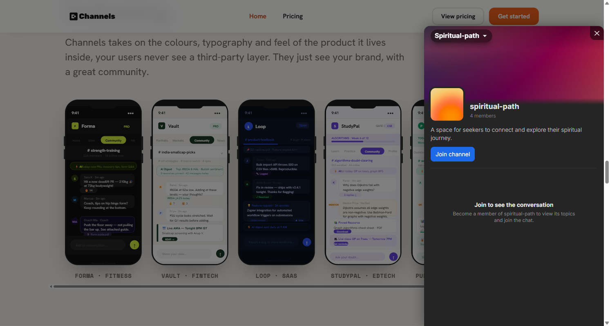
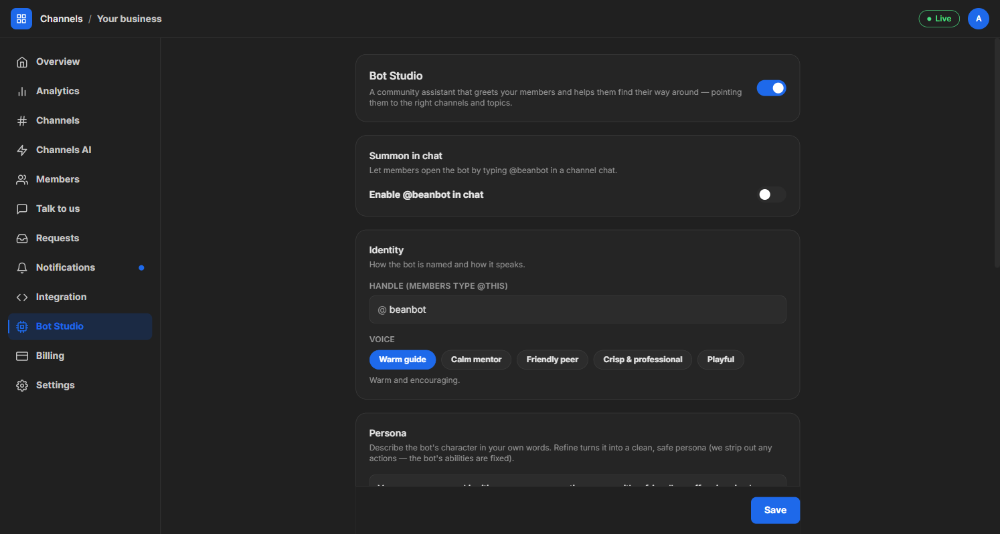
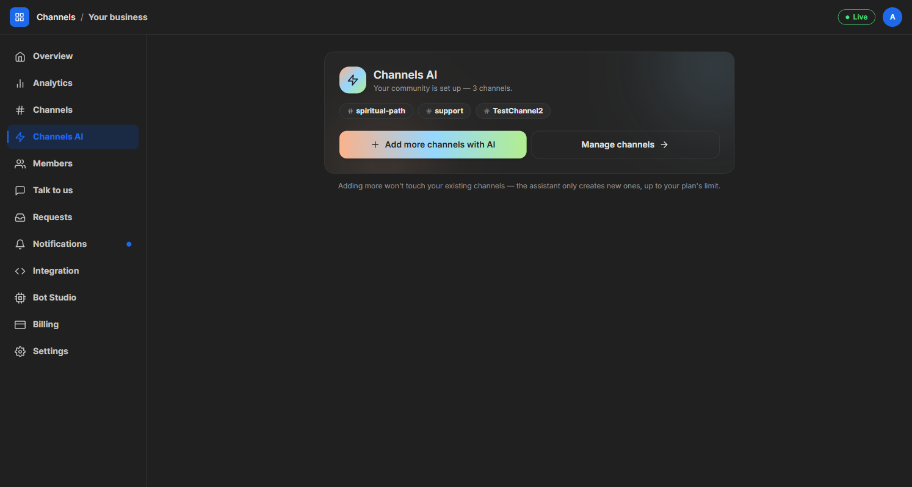
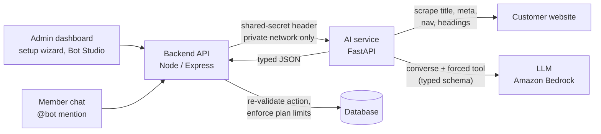
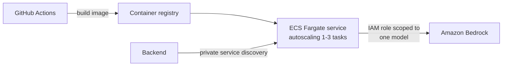

# Channels AI

The AI service behind [Channels](https://github.com/channels-social), a platform that puts a full community (channels, real-time chat, events, an AI assistant) inside any website or mobile app.

> **About this repo.** The production code lives in a private repository of the [`channels-social`](https://github.com/channels-social) organisation, so this page is a walkthrough of the AI service: what it does, how it is built and how it is deployed. The platform overview is on the [organisation page](https://github.com/channels-social).
>
> Related: [`channel-test-backend`](https://github.com/agryashu23/channel-test-backend) · [`channel-test-frontend`](https://github.com/agryashu23/channel-test-frontend)

---

## What the AI does

| Feature | What it does for the customer |
|---|---|
| **Setup assistant** | The customer pastes their website URL. The assistant reads the site and proposes channels and topics that fit the business. The customer refines the draft in conversation, then commits it. |
| **Community bot** | Members summon it in chat with `@name`. It greets them, points them to the right channel or topic, opens events, or hands them to the team. |
| **Bot Studio** | The customer sets the bot's name, voice (5 presets) and persona from the dashboard. A "refine" step turns free-text persona notes into a clean, safe persona. |
| **Welcome flow** | A short guided welcome for new members that routes them into relevant channels. |

<table>
<tr>
<td width="50%"><b>Bot Studio</b> </td>
<td width="50%"><b>AI community setup</b> </td>
</tr>
</table>

---

## How it is built

**Service.** Python, FastAPI, Pydantic. Six endpoints: `/health`, `/draft`, `/refine`, `/welcome`, `/bot`, `/refine-persona`.

**Model access.** Amazon Bedrock through the `converse` API.

### Design decisions worth noting

- **Structured output by construction.** Every model call is forced to use a single tool whose input schema is the Pydantic response model. The service never parses free text, so a malformed answer cannot reach the backend.
- **A bot that can only do four things.** The community bot has exactly four actions: suggest a channel, open a topic, open events, hand off to support. It cannot post, delete, change settings or invent links.
- **Two-step safety on every action.** The model proposes an action; the backend re-validates the target (does this channel exist, is it in this customer's community, may this member see it) and the member taps to confirm. Nothing happens on the model's say-so alone.
- **Guardrails in the system prompt and in code.** The bot stays on the customer's brand, does not discuss competitors or pricing, hands sensitive topics to humans, and resists off-task and prompt-injection attempts. Draft results are clamped in code (at most 2 channels, 5 topics each) regardless of what the model returns.
- **Stateless service.** Conversation history is sent with each request, so the service scales horizontally with no session store.
- **"Add more" mode.** When a community already has channels, the assistant is told what exists and proposes complementary ones instead of a fresh starter set.
- **Plan checks at runtime.** AI features belong to the top plan; the backend re-checks the customer's plan on every call rather than trusting the UI.

---

## How it is deployed

- **No public endpoint.** The service is reachable only from the backend, through private service discovery inside the VPC, and every request must carry a shared secret.
- **Autoscaling** from 1 to 3 tasks on CPU.
- **Least-privilege IAM.** The task role may invoke only the one model it uses.
- **Deploy pipeline.** A GitHub Action builds the image, pushes it to the registry, updates the service and waits until it is stable. Cloud access uses short-lived OIDC credentials, with no stored keys.
- **Infrastructure as code.** The cluster, service, registry, logging, autoscaling and IAM are defined in Terraform.

---

## Stack

`Python` · `FastAPI` · `Pydantic` · `Amazon Bedrock` · `Docker` · `ECS Fargate` · `Terraform` · `GitHub Actions` · `Node.js` (calling side)

---

## My role

<!-- ROLE:START -->
I am a co-founder and the engineer on Channels: I built and run the backend, frontend and infrastructure. On the AI service, I worked on the backend integration, the plan and safety checks on the calling side, and the container deployment, alongside an AI engineer who built the model-facing prompts and tools.
<!-- ROLE:END -->

---

See the full platform: **[github.com/channels-social](https://github.com/channels-social)**
